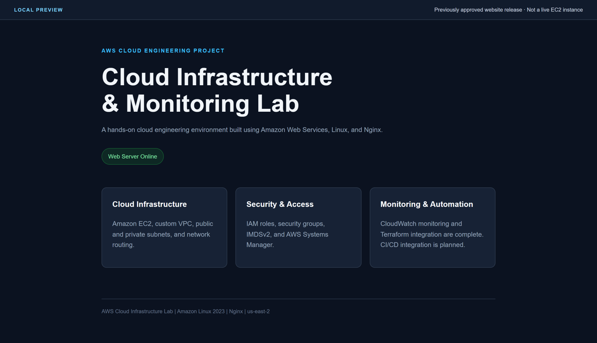

# AWS Cloud Infrastructure, Security & Automation

A hands-on AWS project covering networking, Linux, monitoring, Terraform and
automation. Manually tested infrastructure was adopted into Terraform without
recreation. Bash scripts made server configuration repeatable; GitHub Actions
provided CI and restricted OIDC-authenticated delivery.

**Current operation is CI only.** The instance is stopped, both deployment
workflows are disabled, and the deployment role has federation and session
permission denies. The live results below describe completed tests, not a
currently available website.

## Architecture

[Full-size diagram](docs/diagrams/architecture.svg) ·
[Editable draw.io source](docs/diagrams/architecture.drawio) ·
[Diagram notes and AWS icon attribution](docs/diagrams/README.md)

- **Networking:** a custom `10.20.0.0/16` VPC in `us-east-2`, with two public and
  two private subnets across two Availability Zones. Public subnets route through
  an internet gateway; private subnets have local routing only.
- **Workload:** one Amazon Linux 2023 `t3.micro` running Nginx in a public subnet,
  with an encrypted 8 GiB gp3 root volume. The other three subnets are unused.
- **Access:** Systems Manager instead of inbound SSH, an EC2 service role,
  required IMDSv2, termination protection and HTTP-only inbound access.
- **Monitoring:** native EC2 metrics, Agent memory/disk metrics and Nginx logs,
  a four-widget CloudWatch dashboard, CPU alarm and SNS email notification.

There is no load balancer, NAT gateway or application failover. Terraform manages
AWS resources; server scripts manage selected operating-system files. Application
deployment does not run Terraform or use user-data provisioning.

## Website preview

*Local preview of the previously deployed website release, not a running EC2
instance. Its status label and earlier CI/CD wording are part of that snapshot.*

## Implementation

Terraform manages **33 resources and four data sources**:

| Category | Resources | Contents |
| --- | ---: | --- |
| Networking | 16 | VPC, subnets, gateway, route tables, route, associations, security group and rules |
| Compute and identity | 5 | EC2 with inline root storage, role, two policy attachments and instance profile |
| Monitoring | 6 | Dashboard, alarm, two log groups, SNS topic and separate policy |
| Delivery security | 6 | OIDC provider, role, policy, attachment, boundary and SSM document |

The original 27 resources were imported with zero-change parity checks; six
delivery resources were added later. The [Terraform reference](terraform/README.md)
lists addresses, settings and the stopped-instance public-IP lifecycle exception.

Four scripts handle prerequisites, website deployment, monitoring and verification.
They validate candidates, keep private backups and avoid unnecessary writes or
restarts. The executor pins seven inputs and adds locking, recovery records and a
persistent failure latch. [Server setup](docs/server-configuration.md),
[operations](docs/deployment-runbook.md) and the
[delivery design](docs/authenticated-delivery.md) explain those boundaries.

## Testing and results

[Main CI run 46129889618](https://github.com/BirdIsOffline/aws-cloud-infrastructure/actions/runs/46129889618)
passed **162 Python tests and one mocked Terraform test**, with zero failures or
skips. Checks include Bash/ShellCheck, source hygiene, configuration contracts,
HTML, release integrity, isolated Linux recovery, signed Terraform installation
and locked provider validation. CI uses read-only tokens and has no AWS credentials.

Completed live tests demonstrated OIDC/STS authentication, one restricted SSM
execution, four successful scripts, strict configuration idempotency, website
restoration, HTTP availability and fresh monitoring. One labelled **simulated**
ALARM transition produced a confirmed SNS email; it was not a real CPU breach.

Agent restoration recovered monitoring health but **did not pass complete live
recovery verification**. The separate 225 private offline checks and historical
114-test baseline do not close that gap. The corrected rollback script now in the
repository passed hosted tests but **has not been deployed to AWS**. The
[testing record](docs/recovery-testing.md) explains the evidence and limitations.

## Working with the repository

Stack: Terraform 1.17.2, AWS provider 6.74.0, AWS CLI v2, Amazon Linux 2023,
Nginx, systemd, CloudWatch Agent, Bash, Python and GitHub Actions.

- `terraform/`: infrastructure and mocked tests.
- `scripts/`, `config/`, `website/`: automation, pinned release inputs and homepage.
- `tests/`: authorization, artifact-verification and recovery tests.
- `docs/`: [CI](docs/ci-cd.md), [manual delivery](docs/manual-deployment.md),
  configuration, recovery and diagrams.

Follow the CI guide for local validation. A checkout lacks the private Terraform
state and deployment inputs needed to operate the adopted environment.

## Limits and costs

HTTP has no TLS. Instance permissions and outbound access remain broad. State and
recovery copies are local; there is no off-instance backup or demonstrated
recovery from total instance loss. Root storage is deleted on termination.

Compute, EBS, public IPv4, CloudWatch and notifications can incur charges; stopped
compute still retains storage costs. No Free Tier coverage is assumed. See
[SECURITY.md](SECURITY.md) for reporting, repository protections and remaining
security work.
