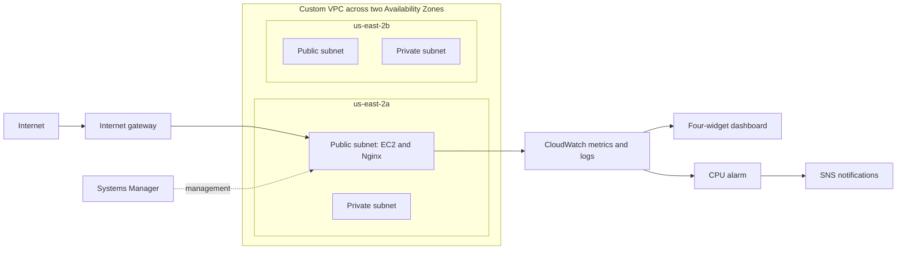

# AWS Cloud Infrastructure, Security & Automation

A standalone AWS infrastructure project that combines Terraform adoption,
Linux server automation, centralized monitoring, and GitHub Actions integration.
Existing infrastructure was imported into Terraform without resource recreation;
server automation was then deployed through Systems Manager and verified for
strict configuration idempotency.

## Architecture

The lab runs in `us-east-2` with a custom `10.20.0.0/16` VPC. Four subnets span
two Availability Zones. One Amazon Linux 2023 `t3.micro` instance serves a responsive
Nginx website in a public subnet. The second public subnet and both private subnets
are available for future workloads; they do not constitute an application failover
deployment. The private route table has no internet default route or NAT gateway.



## Implemented capabilities

- **Terraform:** 27 adopted resources plus six provisioned delivery security
  resources, with four data sources and refreshed zero-change plans. Terraform
  1.17.2 and the committed dependency lock select AWS provider 6.74.0.
  Resource relationships use references;
  account-specific identifiers and state remain outside the repository.
- **Security:** encrypted 8 GiB gp3 root storage, required IMDSv2, EC2 termination
  protection, and Terraform `prevent_destroy` guards on the VPC and instance.
  Systems Manager provides management access without an inbound SSH rule or key
  pair. The instance role supplies Systems Manager and CloudWatch Agent permissions.
- **Monitoring:** CPU, memory, disk, and network dashboard widgets; centralized
  Nginx access/error logs with seven-day retention; custom memory/disk metrics at
  five-minute intervals; and an SNS-backed alarm for CPU averaging at least 80%
  over two consecutive five-minute periods. The confirmed email subscription is
  managed externally; its endpoint is not stored in source or Terraform state.
- **Server automation:** four Bash scripts install only missing prerequisites,
  stage and validate website/configuration changes, preserve private recovery
  backups, and verify services and HTTP content. Live repeat-run testing preserved
  checksums, inodes, mtime/ctime, ownership, permissions, package versions, service
  identities, activation timestamps, and recovery backup inventory.

## Delivery status

| Capability | Status |
| --- | --- |
| Infrastructure adoption and configuration parity | Verified against AWS |
| Controlled server deployment and strict idempotency | Verified on the lab instance |
| GitHub Actions CI | Hosted CI passed; new executor checks validated locally |
| Deployment security infrastructure | Six resources provisioned and verified; 33 total managed resources |
| Authenticated continuous delivery | OIDC/SSM and server idempotency verified; secrets migrated; corrected telemetry verification awaits controlled retest |
| Formal failure injection and rollback/recovery tests | Pending |

The CI workflow runs on pushes to `main`, pull requests targeting `main`, and
manual dispatch. It uses read-only repository permissions and full commit SHA
action pins, with no AWS authentication or deployment steps. The separate manual
delivery workflows use an exact-commit CI gate, a restricted OIDC role and pinned
Systems Manager execution. Manual dispatch is not independent reviewer approval.

## Repository layout

| Path | Purpose |
| --- | --- |
| `terraform/` | Adopted infrastructure and provisioned OIDC/IAM/SSM delivery security |
| `scripts/` | Bootstrap, website deployment, monitoring, and server verification |
| `scripts/ci/` | Reusable static validation and repository hygiene checks |
| `scripts/cd/` | Manual authorization, exact-CI gating and bounded SSM orchestration |
| `scripts/ssm/` | Pinned bundle validation and restricted server executor |
| `config/` | Nginx security drop-in and CloudWatch Agent source configuration |
| `website/` | Responsive static homepage with inline CSS |
| `.github/workflows/` | AWS-free CI and separately authorized manual delivery |
| `docs/` | Server baseline, deployment runbook, and CI/CD design |

## Local validation

With Bash, Python 3, Git, ShellCheck, and Terraform 1.17.2 installed:

```bash
bash scripts/ci/validate.sh
terraform -chdir=terraform fmt -check -recursive
terraform -chdir=terraform init -backend=false -input=false -lockfile=readonly
terraform -chdir=terraform validate
```

Provider initialization requires public registry access but no AWS credentials.
These checks do not access live infrastructure or run server deployment scripts.
Do not apply a fresh checkout against the adopted environment: its private local
state is intentionally absent from Git. Keep state, backups, credentials, raw
inventory, runtime logs, and deployment artifacts outside version control.

## Scope and next steps

This is a single-instance HTTP lab, not a highly available production service.
TLS, further IAM/SNS policy hardening, and formal recovery exercises remain future
work. Terraform preserves the discovered architecture and permissions rather than
silently changing them during adoption. The Agent installation and operating
system configuration are managed separately from infrastructure definitions.

See the [Terraform reference](terraform/README.md),
[server configuration](docs/server-configuration.md),
[deployment runbook](docs/deployment-runbook.md), and
[CI/CD design](docs/ci-cd.md) for implementation details and validation boundaries.
