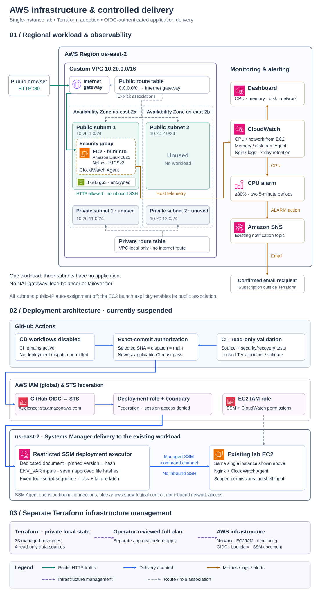

# AWS Cloud Infrastructure, Security & Automation

An AWS lab demonstrating Terraform adoption without resource recreation, Linux
automation and OIDC-authenticated delivery through a restricted Systems Manager executor.

**Current mode: CI only.** CI remains active; both delivery workflows are disabled.
The deployment role denies federation, and its attached policy denies service
permissions for previously issued sessions. EC2 is stopped. Live deployment,
availability, telemetry, and recovery results below are historical tests, not
current service-health claims. Restoring delivery requires a separate security review.

## Architecture

[Full-size SVG](docs/diagrams/architecture.svg) ·
[Editable draw.io source](docs/diagrams/architecture.drawio) ·
[Diagram notes and attribution](docs/diagrams/README.md)

The diagram includes the implemented delivery path, which is currently disabled.

- **Network:** `us-east-2`, custom `10.20.0.0/16` VPC, two public and two private
  subnets across two Availability Zones. Public routing uses an internet gateway;
  private routing is local only. There is no NAT gateway.
- **Workload:** one Amazon Linux 2023 `t3.micro` instance running Nginx in a public
  subnet, with encrypted 8 GiB gp3 root storage. The other three subnets have no
  application workloads.
- **Administration:** Systems Manager replaces inbound SSH and key-pair access.
  An EC2 IAM role supplies Systems Manager and CloudWatch permissions.
- **Observability:** the CloudWatch Agent publishes memory/disk metrics and Nginx
  logs. A four-widget dashboard and CPU alarm support monitoring; SNS delivers
  alarm notifications to a confirmed, externally managed email subscription.

Terraform owns infrastructure. Four Bash scripts manage selected server
configuration and website files. Delivery neither applies Terraform nor uses
provisioners or user data to deploy the application.

## Website preview

*Local browser preview, not a running EC2 instance. Status labels and CI/CD wording
reflect the previously approved website release.*

## Terraform implementation

The first 27 resources were discovered, defined, and imported in dependency order.
Refreshed plans verified parity without infrastructure changes. Six delivery-security
resources were then provisioned from a reviewed saved plan, bringing management
to **33 resources and four separate read-only data sources**.

| Category | Resources | Scope |
| --- | ---: | --- |
| Networking | 16 | VPC, four subnets, gateway, route tables, route, associations, security group and rules |
| Compute and identity | 5 | EC2/root storage, instance role, two policy attachments and instance profile |
| Monitoring | 6 | Dashboard, alarm, two log groups, SNS topic and separate policy |
| Delivery security | 6 | OIDC provider, role, policy, attachment, permissions boundary and SSM document |

Stable map keys preserve import addresses; references replace hardcoded IDs.
The AMI resolves an exact Amazon-owned image name, not the latest release.
The [Terraform reference](terraform/README.md) records every address and adopted setting.

State, backups and private identity inputs remain outside Git. A checkout alone
cannot safely manage the adopted environment. With AWS provider 6.74.0, stopping
EC2 caused public-IP observation drift and a replacement proposal. A narrow
[lifecycle exception](terraform/README.md#public-ipv4-lifecycle-exception) ignores only
`associate_public_ip_address` updates while retaining explicit `true` launch intent
and `prevent_destroy`. Public-IP drift therefore needs a separate check.

## Security and automation

The instance requires IMDSv2 and has termination protection. Terraform destruction
guards protect the VPC, EC2 and selected delivery resources while their definitions
remain present. The web security group permits public HTTP, no inbound SSH, and
unrestricted outbound IPv4. TLS is not implemented.

Historically, OIDC trust required eight exact conditions covering the STS audience,
immutable repository/owner identity, allowed actor, main branch and workflow
references. The role and boundary restricted command submission to one instance
and one dedicated document. Current explicit denies override those retained grants.
No permanent AWS access keys were used for delivery.

The root-running executor pins seven release files, including configuration,
and rejects modified hashes, unsafe paths, links, extra files and oversized bundles.
Private staging, server locking, recovery records and a persistent failure latch
constrain execution. Root tools, package sources and repository administrators
remain trusted. Manual dispatch is authorization, not independent reviewer approval.

| Script | Responsibility |
| --- | --- |
| `bootstrap.sh` | Install missing prerequisites and enable services without blanket upgrades |
| `deploy-website.sh` | Validate, stage and atomically deploy website/Nginx configuration with private backups and rollback |
| `configure-monitoring.sh` | Validate the Agent contract, activate only when needed and support recovery |
| `verify-server.sh` | Check services, Nginx syntax, HTTP and expected content |

Delivery required exact-commit authorization and successful CI before credentials,
then verified the target/document and submitted one bounded SSM execution.
Ambiguous submission or failed verification never triggered automatic redeployment.
See the [security model](docs/authenticated-delivery.md) and
[server baseline](docs/server-configuration.md) for implementation details.

## Verified results

[Hosted CI run 45773288954](https://github.com/BirdIsOffline/aws-cloud-infrastructure/actions/runs/45773288954)
passed both jobs at commit `e40f5c8741ee3dc13a14c259a214b620df5679b9`:
**121 Python tests plus one mocked Terraform test**, with zero skips.
CI checks source hygiene, Bash/ShellCheck, JSON/monitoring contracts, HTML,
release integrity, isolated recovery and locked Terraform validation. Actions use
full SHA pins and read-only permissions; CI has no AWS authentication or deployment privileges.

Historical live verification demonstrated:

- OIDC/STS authentication, restricted SSM execution and four successful script exits.
- Strict configuration idempotency, including unchanged compliant-file ctime,
  package versions, service identities and backup inventory.
- Website rollback restoring exact content and security metadata without an
  unnecessary service restart or reload.
- Fresh memory/disk metrics, access-group log ingestion, expected streams and
  seven-day retention. Metrics use a 300-second collection interval.
- One labelled simulated alarm transition, successful SNS action and confirmed
  email receipt. This did **not** test a genuine CPU threshold breach.

Agent restoration recovered healthy monitoring but **did not pass complete live
recovery verification**. The historical 114-test hosted recovery baseline and
225 separate private offline checks are distinct evidence; neither closes that gap.
The [testing record](docs/recovery-testing.md) preserves failures, timing and limitations.

## Repository and operation

**Stack:** Terraform 1.17.2, AWS provider 6.74.0, AWS CLI v2, Amazon Linux 2023,
Nginx, systemd, CloudWatch Agent, Bash, Python, Git and GitHub Actions.

`terraform/` holds infrastructure; `scripts/` holds server, CI, delivery and executor
code. `config/` holds settings and release contracts; `website/` holds the pinned
homepage; `tests/` contains security and recovery tests.

Use the [CI guide](docs/ci-cd.md) for offline validation and Linux isolation
prerequisites. [Delivery](docs/manual-deployment.md) and
[server recovery](docs/deployment-runbook.md) runbooks describe procedures, not
permission to execute them.

## Costs and limitations

Costs include compute, storage, public IPv4, CloudWatch and notifications; stopping
EC2 leaves storage charges. No Free Tier coverage is assumed.

There is no load balancer, failover tier, remote Terraform backend, off-instance
recovery backup or demonstrated recovery from total instance loss. Root storage
is deleted on termination. Adopted broad instance policies, outbound access and
SNS permissions need separate hardening review. Isolated failure tests do not
establish live disaster recovery or an RTO/RPO guarantee.
